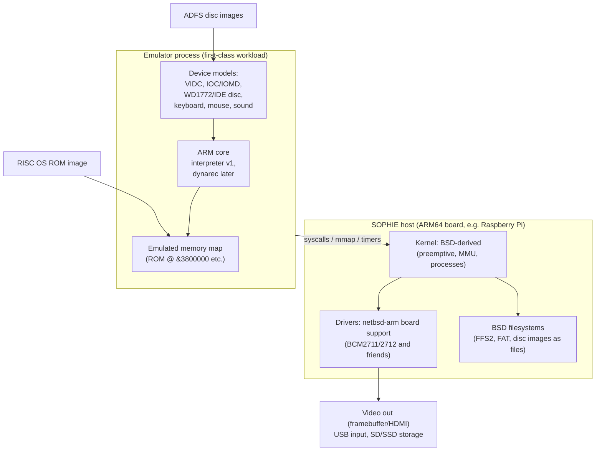
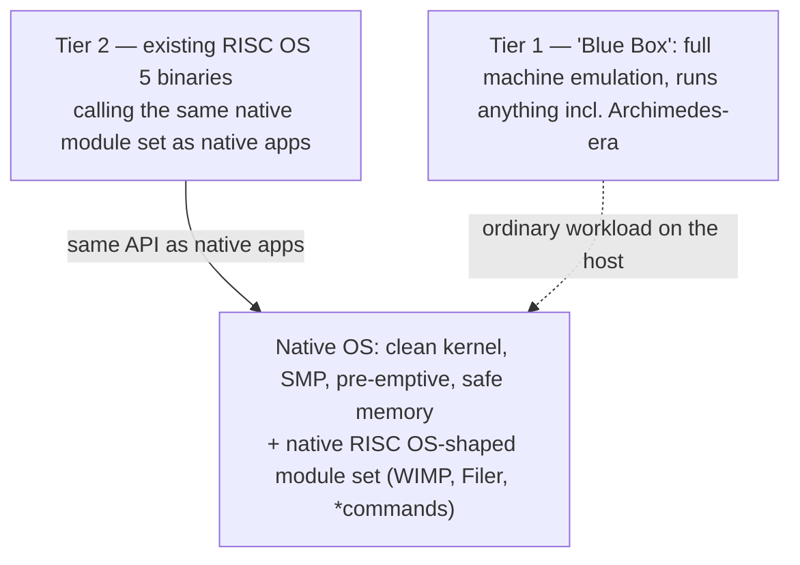

# SOPHIE: Design Specification

**Name:** SOPHIE — chosen in honour of **Sophie Wilson**, designer of the BBC Micro's architecture and of the original ARM instruction set: the person whose ISA this OS emulates, and whose Acorn lineage its desktop idiom descends from. (Whether SOPHIE also expands as a backronym is left open; it does not need to.)

**Project:** SOPHIE, a small operating system for Raspberry Pi (primary target: Pi 400; compatibility range: all Pi models from Pi 3 to Pi 5/500), which: emulates Acorn Archimedes-era and Risc PC machines; emulates / runs, through a compatibility layer, the most recent versions of RISC OS (current stable: RISC OS 5.30; the target moves with ROOL's releases); and **natively runs its own applications within an OS whose structure, look and feel — desktop furniture, `!Application` directories, `*commands`, 3-button mouse — follow the RISC OS idiom, subject to enhancements enabled by the modern BSD-derived core**. **Planned future versions: RISC-V and PowerPC host ports** (see Sections 3 and 4).

**Scope decisions already made:**

- **The OS's own native environment is RISC OS-shaped:** WIMP desktop (iconbar, pinboard, filer), `!Name` application directories, `*command` CLI with Obey scripts, 12-bit filetypes, drag-and-drop data transfer, three-button mouse (Select / Menu / Adjust) — all implemented as *native, modern* code on the pre-emptive, memory-protecting, SMP-capable kernel, not as emulation.
- Compatibility with *current* RISC OS (RISC OS 5, latest stable builds) is a **hard requirement**, delivered via two paths: 1) full-machine emulation (authoritative, runs everything), and 2) the native API matches the RISC OS API, so RISC OS 5 binaries run through the same SWI/WIMP infrastructure the native apps use. Archimedes-era RISC OS 2/3 runs as an emulated legacy guest.
- **Full networking and internet capability (required):** Ethernet and Wi-Fi, DHCP/DNS/TLS, host and guest. All networking is imported as part of the BSD core — the full NetBSD network stack, drivers, and wireless support — with RISC OS-shaped modules (the native Internet/DCM-style module set) layered on top so `*commands` and the filer present network interfaces the RISC OS way.
- **Built-in language = Oberon (marked departure):** Oberon fulfils the role BBC BASIC plays in RISC OS (always-available system language); BBC BASIC is demoted to an app or part of an emulated environment. Details in Section 7.
- The host kernel is a clean, small Unix-like system, free to quarry BSD kernel and driver code.
- No backwards-compatibility obligations on the host kernel's own API surface — the kernel is clean; the RISC OS-ness lives in the module/UI layer above it.

---

## 1. Architecture



Key property: the emulator is an ordinary userland process. All "RISC OS-ness" lives inside the emulated machine, so the host kernel never fights the RISC OS paradigm (cooperative multitasking, shared address space, 26-bit modes). That was the central reason to reject a native compatibility layer.

### What the host must be genuinely good at

| Requirement | Why |
| --- | --- |
| Large contiguous anonymous mappings | The emulated machine's RAM map and MMIO regions |
| Stable, low-jitter timers (50/60 Hz pacing) | VDU smoothness, RISC OS vsync-driven poll loops |
| Low-latency input injection (USB HID) | Emulated keyboard/mouse devices |
| Cheap framebuffer blit path to video out | VIDC video modes doubled to modern 32bpp output |
| Block frontend treating disc images as files | ADFS/FileCore images on the host FS |
| Clean driver layer to strip from BSD | Board bring-up beyond the Pi |
| **Full Ethernet and Wi-Fi networking** — quarried from the NetBSD core: NIC drivers (Genet for BCM2711/2712, LAN78xx/Ethernet USB on Pi 3), Wi-Fi via bwfm-class drivers plus association (WPA2/WPA3) | A networked OS: native internet stack for every tier |
| **Full TCP/IP stack + internet capability** (SMP-scalable sockets, DHCP, DNS, TLS via the BSD code base; RISC OS-shaped network modules on top) | Native apps' networking; universal connectivity across desktop, CLI, compat binaries and guests |
| Guest-side virtual NICs (emulated machines see an Ethernet interface) with host-side NAT/bridging | Emulated and compat RISC OS environments get full internet access |

## 2. Emulator core

- **v1: interpreted ARM.** ARMv2/v3 (Archimedes: ARM2, ARM250, ARM3) plus ARM610/ARM710 for RISC OS 3.x-class machines, including the 26-bit PC/flags model. An interpreter is verifiable against the ARM ARM and, on GHz-class ARM64 hardware, has 10-50x headroom over the ~8 MIPS of the real 1987-1992 machines.
- **Validation strategy:** run diagnostic ROMs and known-good Archimedes software, compare against reference emulators (ArcEm, Arculator, RPCEmu) for mode-switch, exception, and flags edge cases.
- **Core-extension requirement for RISC OS 5 (M2.5):** RISC OS 5 ROMs target ARMv4 (ARM710 / StrongARM, e.g. SA-110), so the interpreter needs the ARMv4 additions beyond the current ARMv2/3 implementation: halfword transfers (LDRH/STRH, LDRSH/LDRSB byte variants), semaphore instructions (SWP remains), and careful StrongARM-specific behaviour (e.g. its documented differences in writeback and timing tolerances). This stays in the 26-bit PC+flags model — RISC OS 5 does not use the 32-bit ARMv3+ modes. The current arm26 core (Appendix A) provides the ARMv2/3 foundation these extensions build on.
- **v2 (optional): dynarec.** Emit host ARM64 code with a cached-translations scheme. Optional because headroom already exceeds need; do it for fun or for heavily-CPU-bound Archimedes games.
- **Frontier (explicitly deferred): semi-native ARM guests.** Since the host is ARM, 32-bit RISC OS 5 guests could run semi-natively under an exception-level partition (ARMv8 removed 26-bit modes, so Archimedes-era code still needs emulation under any scheme). Keep the CPU-core interface clean so a semi-native backend *could* slot in later, but don't design around it.
- **Host-ISA portability rule:** no host-ISA assumptions inside the emulator core; host optimisations stay pluggable. Porting to a RISC-V or PowerPC host becomes a recompile plus board work, not a redesign. This rule is the cheaper cousin of a mistake to avoid: any host-specific trick (the ARM host's AArch32-at-EL0 near-native tier, in particular) must sit *beside* the portable core, never inside it.

## 3. Hardware targets

1. **Primary development target:** Raspberry Pi 400 (BCM2711, Cortex-A72) — the keyboard-in-case form factor makes it a natural "Acorn-like" machine for this project.
2. **Compatibility target:** all current Raspberry Pi models, including the Pi 3 (BCM2837, Cortex-A53), Pi 4 (BCM2711), Pi 5 (BCM2712, Cortex-A76), and Pi 500 (Pi 5 platform in a keyboard case).
3. **Secondary:** other well-NetBSD-supported ARM64 boards (BeaglePlay-class, RockChip-based) once the guest stack works end-to-end.
4. **Planned future versions:** RISC-V hosts (e.g. VisionFive 2 / Milk-V class) and PowerPC hosts (if suitable boards surface — see notes below), by the host-ISA portability rule above.

Model-spread notes for portability architecture:

- **SoC generations:** BCM2837 (Pi 3) / BCM2711 (Pi 4, 400) / BCM2712 (Pi 5, 500). Driver code must be selected per SoC generation; NetBSD's Raspberry Pi platform support already spans all three, which is a direct benefit of the BSD-quarrying decision.
- **VideoCore generations:** VC4 (Pi 3/4/400) vs VideoCore VII (Pi 5/500). Video output should target the firmware framebuffer/mailbox interface — the common abstraction across all models — rather than direct VC register pokes, so the same code path works from Pi 3 to Pi 500.
- **AArch32 at EL0**: available on Cortex-A53, A72 and A76 (all listed models), so the future near-native RISC OS 5 compatibility tier remains usable across the whole model range — but it is a sunset feature on ARM's newer cores, so the dynarec fallback stays on the roadmap for newer SoCs beyond the Pi family.
- **Pi 400 and Pi 500 are Pi 4 / Pi 5 silicon in different cases** — no extra porting work, only extra validation targets.
- **Future-version plan (RISC-V):** NetBSD's riscv port and growing upstream device support make it a straightforward second host ISA. Both future host ISAs are 64-bit, little-endian-friendly targets and neither offers AArch32, so on these hosts *unmodified RISC OS 5 binaries* need dynarec (M5) — while the native desktop, native apps and the emulation tier all port normally. This is precisely why the host-ISA portability rule keeps the emulator core and the native module set ISA-clean.
- **Future-version plan (PowerPC):** included as a planned future host architecture (classic big-endian PowerPC; e.g. embedded/e500-class or AmigaOne/WarpSpace-style hardware if available, or QEMU-emulated boards during bring-up). PowerPC hosts have two structural consequences worth designing for from day one: (a) endianness — write the emulator memory layer so guest little-endian accesses map through the host's byte order rather than assuming a little-endian host; (b) alignment — PowerPC permits unaligned scalar loads where many ARM/RISC-V cores trap; keep guest memory access fully mediated by the core's read/write functions so both differences stay invisible. The compat-tier test suite is the portability insurance: it must pass identically on every host ISA.
- **Guest portability is unaffected:** the guest architecture is ARM (26-bit and 32-bit eras) by project scope; a future *PowerPC guest* (e.g. classic Mac emulation) would be a separate emulation module, not a host port, and is explicitly out of current scope.

Host userland can be minimal: a loader, the emulator, a tiny shell, and a way to install disc images. A kitchen-sink userland is out of scope.

## 4. Milestone ladder

```mermaid
flowchart LR
  M1["M1: Pi bring-up on BSD base\nboot to shell on SD"] --> M2["M2: ARM interpreter boots\nRISC OS 2/3 ROM in emulator"] --> M3["M3: Desktop\nWIMP, keyboard, mouse,\nADFS disc images"] --> M4["M4: Sound + polish\nVIDC sound, timing accuracy"] --> M5["M5: dynarec /\nsemi-native guest\n(optional)"] --> M6["M6: Native desktop begins<br/>WIMP, filer, iconbar, *commands<br/>+ first native app"] --> M7["M7: Unmodified RISC OS 5 binary<br/>runs natively in the desktop"] --> M8["M8: compat API completion<br/>(Carbon-style library)"] --> M9["M9: RISC-V host port (future)"] --> M10["M10: PowerPC host port (future)"]
```



- **M1** is the only milestone touching real hardware bring-up; its output is a bootable image. Networking belongs to M1 too: Ethernet + DHCP on the target board (NetBSD's Genet/LAN78xx drivers imported from the core) is the acceptance test that the BSD quarrying decision pays off; Wi-Fi (bwfm-class driver + WPA association) follows on the same milestone if firmware loading cooperates.
- **M2-M4** are all emulator work; they can proceed on any host and be rehosted trivially.
- **M5** is an optimization, not a dependency, of M6.
- **M6-M8 are the native-desktop and compat-binary milestones** (detailed in Section 7): M6 native vertical slice; M7 the first unmodified RISC OS 5 binary natively in the desktop; M8 the recompile-against-native library. Together they deliver the project's identity: a modern OS with RISC OS structure and feel.
- **M9 (RISC-V) and M10 (PowerPC)** are the planned future-version host ports. They depend only on the emulator tier (M2-M4) plus the native desktop being ISA-clean. On these hosts, unmodified RISC OS binaries need dynarec (no AArch32 hardware execution), while native apps port normally; the test suite passing identically on each host ISA is the acceptance criterion.

### Status (2026-11-22)

- **CPU core started (M2 groundwork).** An ARMv2/3 26-bit interpreter core exists as a tested JS reference implementation (`arm26` canvas: core + 42-assertion test suite covering data processing, shifter carries, MUL, SWP, single/block transfers incl. STMFD/LDMFD ordering and r15-as-CPSR stores, exception entry (SWI/IRQ/undefined), MOVS pc CPSR restore, TEQP mode switches, and a loop test). Measured ~70 MIPS in interpreted JS — ample headroom over the ~8-14 MIPS of real Archimedes-era hardware. Next M2 steps: memory-mapped I/O dispatch layer, then the Archimedes base machine (MEMC, VIDC, IOC/IOMD disc + keyboard) and ROM boot.
- **Porting note:** the JS core is deliberately C-shaped for a mechanical C port in the build environment.

## 5. Licensing

**Distribution is a goal:** the project is non-commercial but intended for public release and use by others. Licence choices are therefore made for adoption, not just convenience.

- **Kernel/driver tier: Apache 2.0 or BSD-2.** BSD kernel/driver mining stays frictionless with notices retained; all original host code under the project's own permissive licence. Rationale, per the related open-source economics notes: permissive licensing maximises adoption ("free to take, with value flowing to whoever builds on it"), which suits a small OS competing for every user.
- **Emulator tier: permissive, written clean.** Implement from primary specifications only: the ARM ARM (instruction set), Acorn IOMD/VIDC datasheets, and RISC OS behaviour from the Apache-2.0-licensed ROOL sources and RISC OS 5 PRMs. RPCEmu (GPL v2, [marutan.net](https://www.marutan.net/rpcemu/index.php)) and its more active fork [RPCEmu Extended](https://github.com/andrewtimmins/rpcemu-extended) are studied as *reference and credit only* — architecture walkthroughs, edge-case behaviour, known-bug avoidance — with no code or pseudocode-level derivation, so the tier never becomes GPL-derived. Arculator (freeware, closed source) is likewise behaviour-reference only. Credit all studied references prominently in the documentation.
- **Optional pragmatic fallback:** if a working emulator is wanted before the clean core is ready, a GPL v2 RPCEmu-derived emulator may be distributed as a separate, optional component. GPL permits non-commercial redistribution provided source is shipped; the separate-process boundary keeps the permissive tiers untainted either way.
- **Derivation boundary note:** pseudocode or re-expression of GPL code does not create a clean implementation — only specification-driven implementation does.
- **RISC OS ROM images:** the ROOL sources are published under Apache 2.0 by RISC OS Open/Castle Technology, but ROM *images* you load into the emulator are a separate acquisition problem from the emulator code itself. Keep that boundary explicit in any README. RPCEmu-extended-style precedent: ROOL USB modules carried as data in a guest "ROM" and loaded at runtime stay under Apache 2.0/BSD, outside any GPL, because nothing is linked.
- **Wi-Fi/Ethernet firmware blobs:** the Pi's Wi-Fi silicon needs proprietary firmware (Broadcom/Cypress family; redistributable under its own terms, not BSD-licensed). Firmware loads at runtime as data, exactly like the ROM-image pattern above — no licence intermixing. Document the firmware acquisition boundary in the README alongside the ROM boundary.

## 6. Open questions

- ~~Oberon dialect for the built-in language~~ **Resolved:** **Oberon-07, implemented as a bytecode interpreter** with an interactive front end (compiler as a later enhancement emitting the same bytecode first). Module linkage resolved at load time by design. Rationale in Section 7; the interpreter ships self-hosted in the base system.

- Board bring-up vs emulator-first sequencing: develop the emulator as a userland app on a stock OS (NetBSD/Linux/macOS) from day one, and treat M1 host bring-up as swappable infrastructure. Recommended default: emulator-first.
- Pi bare-metal vs NetBSD-base: NetBSD-derived base is the conservative, fastest path; a from-scratch kernel makes M1 much larger and buys little for this goal.
- ~~Which RISC OS versions to target for the first "good" experience~~ **Resolved:** current ROOL RISC OS 5 (5.30 stable and later) is the required target via the emulation path (M2.5), with Archimedes-era RISC OS 2/3 retained as legacy guests. Remaining choice: early bring-up order — RISC OS 3.1x on a simpler emulated Archimedes first (softer device set, easier first boot) before the Risc PC-class machine that runs RISC OS 5. Recommended: Archimedes first for core bring-up, Risc PC immediately after.
## 7. OS identity and compatibility strategy: RISC OS in structure, look and feel, on a modern core

The project's scope decisions, refined across design sessions — now a three-pillar design:

- **Pillar 1 — Emulation (runs everything):** Archimedes / Risc PC machines are emulated, running real ROMs, including current ROOL RISC OS 5 builds. This is the authoritative, exhaustive compatibility path, including badly-behaved software.
- **Pillar 2 — Compatibility layer (runs existing RISC OS 5 binaries):** motivated by RISC OS's fundamental deficits — no multi-core, no pre-emptive multitasking, no safe memory — this is the same problem Apple faced with Copland: RISC OS software running on a real multi-core pre-emptive kernel with memory safety, running *through* the host rather than in spite of it.
- **Pillar 3 — Native applications and desktop (the OS's own identity):** the OS's own environment follows the RISC OS structure, look and feel natively, enhanced by the modern core. It should be more than an emulation engine and compatibility layer: it is a modern RISC OS-in-spirit operating system.

**The convergence insight (central architectural decision):** pillars 2 and 3 are the *same infrastructure*. Because the OS's own API is the RISC OS API (SWIs, WIMP, modules, `*commands`) — implemented once, natively, on the modern kernel — the "compatibility layer" is not a Wine-style translation to a foreign Unix API. It is simply the OS's own module set, which RISC OS 5 binaries call directly (with the AArch32 trap dispatcher providing the entry point on ARM hosts). Native apps and compat apps speak the same language; only their provenance differs. This is Copland's goal executed NeXT-style: clean foundation, RISC OS-shaped toolbox above it, compatibility attached out-of-body.

### The Copland lesson

Copland failed as a project (schedule, brown-field integration of a modern kernel into a rotting toolbox). Apple succeeded by putting compatibility *around* a clean foundation, in tiers:



Lesson for this project: the kernel is built clean and modern; compatibility is attached out-of-body, never allowed into the kernel's design space. Compatibility promises are scoped to a *well-behaved subset*, not exhaustive equivalence.

### Why RISC OS 5 is an unusually good Wine target

- **RISC OS 5 is already 32-bit.** No 26-bit problem in this tier; binaries are plain AArch32, near-executable in EL0 on today's Pi-class SoCs (note the sunset: ARM's newer cores drop AArch32; dynarec fallback will be needed eventually, and on RISC-V and PowerPC hosts there is no AArch32 at all — unmodified binaries there need dynarec, while native apps, written or recompiled for this OS, are unaffected).
- **The system interface is one narrow, enumerable choke point: SWIs.** Every interaction with the outside goes through SWI dispatch — a syscall table. This is Wine-shaped.
- **The WIMP redraw protocol is compositor-shaped.** Apps are told when/where to repaint (clipped rectangles, plot into their own window), so a per-app private framebuffer view composited by a WIMP server solves the direct-VIDC-poking problem in a principled way.

Hard parts and techniques:

| Problem | Technique | Precedent |
| --- | --- | --- |
| Apps never yield (cooperative Wimp_Poll) | Each app its own process; Wimp_Poll = blocking syscall into a WIMP server; spinning app is killable without holding the machine | OS X Classic / WOW |
| Vector claims, module patching of the live OS, runtime SWI registration | Per-process virtualised memory map of the "OS" (ROM at high memory, module chains); system-wide claims mediated by the layer | Wine loader / wineserver |
| Direct screen plotting | Per-app private framebuffer view, composited; sound via per-session virtual DMA channel | Win16 GDI compat |
| Apps that patch the live OS to customise behaviour | These stay in the emulator tier or die (the RISC OS cultural pattern this tier cannot carry) | Carbon's 15% rework rate |

### The native desktop: RISC OS structure, look and feel (Pillar 3 fleshed out)

The OS's own desktop and applications must be recognisably RISC OS to a RISC OS user, while structurally modern. Conformance checklist (user-visible surface):

- **Desktop furniture:** iconbar on the left/bottom edge (plugins for drives, printers, tasks), pinboard, filer windows with RISC OS furniture, window templates and fonts.
- **Application directories:** `!Name` directories with `!Boot`, `!Run`, `!Sprites`, `(!Resources)` etc. — launching an app means running its `!Run` (so `!Program`-style apps, named and launched the RISC OS way). Started apps park on the iconbar.
- **`*commands` CLI:** the shell is `*command`-based (*Cat, *Dir, *Copy, *Set, *Obey scripts) — running as a normal pre-emptible process, piping through the same module set as the desktop. Command registration follows the module `*command` convention so native modules contribute commands.
- **Filetypes:** 12-bit RISC OS filetypes surfaced as filesystem metadata (load/exec-address emulation in xattrs for compat payloads; native files carry the filetype natively). Type-directed actions, type sprites, drag-to-load.
- **Drag and drop everywhere:** files anywhere → app icon; app icon → filer window to save; selection → selection transfer, RISC OS's most distinctive interaction.
- **Three-button mouse:** Select (act/confirm), Menu (context per object), Adjust (modify/extend — toggles selection, acts on alternatives, closes-with-adjust-flips). Notably more functional than two-button desktops; the WIMP protocol carries the tri-state from input through to apps.
- **Module system:** the native module set (Wimp, Filer, Font, FileSwitch, ...) follows RISC OS structure and naming, but each module runs in protected space with pre-emptible servers per task — the RISC OS *shape*, not its single-address-space substance.
- **Built-in system language: Oberon (a marked departure from RISC OS).** Where RISC OS carries BBC BASIC in ROM as its universal, always-available language — the thing that runs `!Boot`-adjacent utilities, quick one-liners at the command line, and half the shareware corpus — this OS ships **Oberon** in that role. BBC BASIC is *demoted to an app* (or simply part of an emulated environment): nothing system-level depends on it.
  - **What "the BBC BASIC role" means for Oberon:** present in the base system image so it's usable the instant the machine boots; reachable from the `*command` CLI; the natural language for system utilities, `*command` implementations and small apps; module-structured so Oberon modules register `*commands` and interface with the native module set directly.
  - **Bytecode interpreter first, compiler later (resolved):** the BBC BASIC role is fundamentally interpreter-shaped — immediacy, type-a-line-and-run, errors land in a live debugger state. The built-in component is therefore an **Oberon-07 bytecode interpreter with an interactive front end**: a compiler front end to a compact bytecode, resolved-module loads, and a wrapper giving REPL-style immediacy. Rationale: (a) instant availability beats raw performance for utilities, shell glue and `*command` implementations; (b) a bytecode interpreter is ISA-portable from day one — it runs identically on the ARM64, RISC-V and PowerPC hosts with zero per-ISA work, where a native compiler needs a code generator per architecture; (c) the bytecode format doubles as the OS's universal "runs everywhere on this OS" application format (the UCSD p-System pattern); (d) BBC BASIC V itself was an interpreter — the role demands the form. A native compiler arriving later emits the same bytecode first, then native code, and costs nothing to have skipped initially.
  - **Module linkage lives in the interpreter (design-in early):** imports resolve at module-load time against the bytecode module repository, preserving Oberon's module discipline and type checking across modules in the built-in tool. This must be designed into the bytecode and loader from the start, not retrofitted — Oberon's whole structure story rides on it.
  - **Dialect (resolved): Oberon-07** — Wirth's final dialect. The grammar is famously tiny, so the interpreter is small, verifiable, and in the system's code budget (comparable to Wirth's own compiler front end plus a stack VM). The self-hosting requirement applies to the interpreter: the base-system Oberon tooling runs on this OS. (Oberon-2 with `voc`-class toolchains was the alternative; rejected for dialect coherence and the minimal-grammar advantage. Licence discipline unchanged: verify any imported implementation's terms before derivation — the same discipline as the emulator tier.)
  - **Why this fits the project:** Oberon was designed by Wirth as the language *and* OS of the Ceres workstation line — an operating-system-and-language co-design, exactly the shape of this project. BBC BASIC's historic virtue was universality and instant availability; interpreted Oberon-07 gives that with module structure, strong typing, and bytecode that the modern pre-emptive core runs as ordinary protected processes.
  - **Interaction with the tiers:** emulated RISC OS guests and compat binaries keep their own BBC BASIC (it comes with the ROM / the app); native system utilities and first-party apps are written in Oberon; third-party native apps may use anything that compiles for the OS.

Enhancements expected from the modern core (visible from day one vs. stock RISC OS):

| RISC OS limitation | Native implementation |
| --- | --- |
| Cooperative single-task Wimp | Pre-emptive per-task scheduling; no task can starve the desktop; heavy 3-D rendering or Python sessions just run |
| Single core | SMP-aware WIMP server, fonts, compositing; app-requestable worker threads as a new, optional API alongside the old one |
| No memory protection (one crash kills all) | Per-task address spaces; a crashed task closes its windows and everything else survives |
| Module/OS shared address space | Modules are processes/servers; their SWIs are fast IPC; system-wide vector claims arbitrated by consent |
| 26-bit-era design, 2GB ceilings | 64-bit throughout; 64-bit file offsets; large RAM supported |
| RISC OS-era internet stack, single-threaded module servers | Full modern TCP/IP (SMP-scalable), TLS, DNS, DHCP straight from the BSD core; RISC OS-shaped network modules (`*`-controllable, filer-visible) sit on top — every tier (native, compat binary, guest) gets full internet access |

Precedent worth studying: **ROX Desktop** (Thomas Leonard's RISC OS-style desktop for X11) proved most of the user-visible surface (pinboard, appdirs, drag-and-drop) can live on a Unix-shaped base — but it stayed an alien overlay. Here the *entire* module set is native, so the desktop is the OS, not a costume.

### Milestone extensions (compatibility + native track — required, not optional)

- **M2.5 (new, inserted into the emulator ladder):** emulated Risc PC-class machine (StrongARM, IOMD, VIDC20) boots a **current ROOL RISC OS 5 ROM build** (5.30 stable and later) to desktop. This is the emulation-path satisfaction of the current-RISC OS requirement, and doubles as the behavioural oracle for the native tier.
- **M6 (native desktop begins):** first genuinely native vertical slice on the modern kernel: WIMP server (pre-emptive, per-task address spaces), iconbar + filer + `!App` launching, `*commands` shell with the core command set, 12-bit filetype metadata, three-button input protocol. One native app (written for this OS, speaking the module set directly) runs alongside the emulation tier.
- **M7 (compat binaries join the desktop):** a well-behaved RISC OS 5 application runs *unmodified* in a native process — direct proof of the convergence insight — composited into the same desktop as native apps.
- **M8 (API completion):** the "Carbon-style" library so RISC OS apps recompile against the native kernel directly (SMP, real memory protection, 64-bit file offsets), and the compatibility-matrix corpus run against each ROOL ROM build.
- **Definition of "most recent RISC OS":** latest ROOL stable (currently 5.30) plus rolling development builds; the target moves with ROOL. Because the emulated machine is generic Risc PC hardware and ROOL publishes ROM images for it, new RISC OS releases drop into the emulator tier without porting work. The native module set tracks new SWIs/modules via a compatibility-matrix test corpus, refreshed against each ROM build.

## 8. Reference emulators and reuse policy

- **RPCEmu (mainline, [marutan.net](https://www.marutan.net/rpcemu/index.php))**: GPL v2, by Sarah Walker and Peter Howkins; alive but slow-burn (v0.9.5, self-described "alpha quality"). Covers Risc PC / A7000 only — RISC OS 3.5-5, *not* the Archimedes era. Interpreter and dynarec backends, networking, HostFS.
- **[RPCEmu Extended](https://github.com/andrewtimmins/rpcemu-extended)** (fork): considerably more active — ShareFS networking, IDE fixes, USB (carrying ROOL's Apache-2.0/BSD USB stack as guest-ROM data, outside the GPL — a licence-boundary precedent worth copying), debugger and machine inspector.
- **Use:** *reference and credit only* — architecture walkthroughs, edge-case behaviour, known-bug avoidance. No code or pseudocode derivation, so the permissive emulator tier never becomes GPL-derived. (Pseudocode does not launder GPL: only specification-driven implementation is clean.)
- **Arculator**: freeware, closed source — the Archimedes-era behaviour reference. Behaviour-reference only; never read or copy code.
- **Authoritative specs for the clean core:** the ARM ARM, Acorn IOMD/VIDC/MEMC datasheets, and the Apache-2.0 ROOL tree + RISC OS 5 PRMs. Implement from these; study the emulators.

## 9. Implementation status log

**2026-11-22 — CPU core (M2 groundwork) built and verified.**

- `arm26.mjs`: ARMv2/3 26-bit interpreter (full data processing with 26-bit CPSR-write semantics; MUL; SWP; LDR/STR with unaligned-load rotation; LDM/STM all four stack orders with lowest-register-at-lowest-address and r15-as-CPSR stores; exception entry for SWI/IRQ/FIQ/undefined with banked r14; banked register sets USR/FIQ/IRQ/SVC).
- `arm26.test.mjs`: 42 assertions, all passing. Covers flags/carry edge cases, exception entry state, MOVS pc full-CPSR restore, TEQP mode switch, loops, stack round-trips.
- Measured ~70 MIPS in interpreted JS — ample headroom over ~8-14 MIPS real Archimedes-era hardware.
- Bugs found by testing (and worth re-checking after any C port): SWI dispatch was shadowed by the coprocessor catch (every SWI landed on the undefined vector); multiply Rs field extracted from the wrong bit positions; unaligned LDR rotated an unaligned word read instead of rotating the aligned word by (addr&3)*8; block transfers assigned stack slots in the wrong order for descending modes; ADDS immediate encodings miscomputed by hand more than once — the lesson is *test every encoding*, which the suite now does.
- Test-exit convention: `SWI 0` halts the run loop (no exception), used by test harnesses; ROM-side code never sees it.

## 10. Implementation brief (work packages for build sessions)

This section is the hand-off to coding sessions (Vibe Code etc.). Each work package is self-contained, testable without target hardware, and ordered. Conventions below apply to every package.

### Code conventions

- **Language:** C (C11) for the emulator core and native components; the reference implementation (Appendix A) is deliberately C-shaped for a mechanical port. No C++.
- **Build:** plain Make-based build (host build first: macOS/Linux `cc`; `aarch64` cross target via `aarch64-none-elf-` / NetBSD `build.sh` later). No build system heavier than make for WP1-WP3.
- **Directory layout:**
```text
sophie/
  emu/            # emulator tier: arm core + machine models
    core/         # arm26 (v2/3), armv4 extensions later
    mach/         # memory map, MEMC/VIDC/IOC device models
    tests/        # transplanted suite + new vector tests
  native/         # future: module set, WIMP server (M6+; not started)
  docs/spec.md    # export of this specification
```
- **Testing rule:** every work package ends with the full test suite passing on the host. Tests are hand-encoded instruction words (see Appendix B) — transplanted verbatim to C first, then extended.
- **Traceability rule:** keep a running correspondence between test names and the spec sections they verify; the suite doubles as the RISC-V/PowerPC host-port acceptance criterion (Section 3).

### Work packages (in order)

| WP | Deliverable | Acceptance criteria |
| --- | --- | --- |
| **WP1** | C port of `arm26` (Appendix A) + transplanted test suite | All 42 assertions pass; the C core is ISA-portable (no endian/alignment assumptions — mandated by the PowerPC plan); benchmark within 3x of the JS reference on the same host |
| **WP2** | MMIO dispatch layer: memory callbacks (rd8/wr8/rd32/wr32) routed through a device registry replacing the flat-RAM mask | Regression: existing tests pass through the new memory layer; a dummy MMIO device test proves dispatch |
| **WP3** | Archimedes base machine model: MEMC (memory map control), VIDC (video: framebuffer modes to host window), IOC (timers, IRQ/FIQ lines, keyboard scanning) | Dummy ROM (hand-built) boots far enough to read/write emulated memory and receive timers; IRQ-driven CPU loop runs for 1M cycles without lockup |
| **WP4** | ROM boot: load a real RISC OS 2/3 ROM image (acquisition per Section 5 boundary) | Emulated machine starts executing ROM init; milestone target M2 reached when the boot reaches a stable polling loop (screen init is WP5) |
| **WP5** | VIDC video output + keyboard input via the host OS window layer | RISC OS boots to a visible desktop: M2/M3 checkpoint |
| **WP6** | ARMv4 core extensions (halfword transfers, StrongARM behaviours) | Core-extension tests pass; Risc PC-class machine added; M2.5 begins |
| **WP7** | Disc image frontend (FileCore images as files, WD1772/IDE model) | RISC OS sees a filing system; apps can be loaded (M3) |
| **WP8+** | M4 sound/polish, then re-plan: M6 native desktop vs M5 dynarec | — |

### Environment notes

- Sessions build and test on the host machine only — WP1-WP7 need no target hardware.
- The sandbox used for the reference implementation resets between sessions, but published canvases persist: recover the code from this document's appendices (or the arm26 code canvases), as has been done once already.
- Environment constraint observed during the reference work: some sandbox environments forbid compiler installation. Vibe Code sessions on the local machine have normal toolchains and are unaffected.

## Appendix A — `arm26.mjs` (core, v1)

```javascript
/**
 * arm26 — ARMv2/ARMv3 26-bit interpreter core (reference implementation)
 *
 * Project: "Developing a small OS" — emulator tier, milestones M1/M2.
 * Target semantics: Acorn ARMv2a/ARMv3 cores (ARM2, ARM250, ARM3, ARM610/710),
 * i.e. the 26-bit PC+flags-in-r15 model used by all Archimedes / early Risc PC
 * RISC OS guests. No 32-bit modes (ARMv3 MRS/MSR handled as undefined-opcode,
 * exactly how ARMv2a hardware treats them).
 *
 * Reference for a future C port: this file is deliberately C-shaped
 * (no closures over loop state, explicit masks, single flat memory array).
 *
 * Not implemented yet (device models are separate): IOMD/IOMD1, VIDC, FPA.
 * All coprocessor instructions raise undefined-instruction exceptions.
 */

export const FLAG_N = 0x80000000;
export const FLAG_Z = 0x40000000;
export const FLAG_C = 0x20000000;
export const FLAG_V = 0x10000000;
export const FLAG_I = 0x08000000;
export const FLAG_F = 0x04000000;
export const FLAG_NZCV = 0xF0000000;

export const MODE_USR = 0;
export const MODE_FIQ = 1;
export const MODE_IRQ = 2;
export const MODE_SVC = 3;

export const PC_MASK = 0x03FFFFFC;

const VEC_RESET = 0x00;
const VEC_UNDEF = 0x04;
const VEC_SWI   = 0x08;
const VEC_PABT  = 0x0C;
const VEC_DABT  = 0x10;
const VEC_IRQ   = 0x18;
const VEC_FIQ   = 0x1C;

const OPCODES = ['AND','EOR','SUB','RSB','ADD','ADC','SBC','RSC',
                 'TST','TEQ','CMP','CMN','ORR','MOV','BIC','MVN'];

export class Arm26 {
  constructor(ramSize = 0x100000) {
    if ((ramSize & (ramSize - 1)) !== 0) throw new Error('ramSize must be a power of two');
    this.ramSize = ramSize;
    this.ramMask = ramSize - 1;
    this.ram = new Uint8Array(ramSize);

    this.r = new Uint32Array(16);          // r15 doubles as the CPSR (flags|PC|mode)
    this.bankUsr = new Uint32Array(7);     // USR r8-r14 (also SVC/IRQ r8-r12)
    this.bankSvc = new Uint32Array(2);    // SVC r13,r14
    this.bankIrq = new Uint32Array(2);    // IRQ r13,r14
    this.bankFiq = new Uint32Array(7);    // FIQ r8-r14
    this.irqPending = false;
    this.fiqPending = false;
    this.cycles = 0;
    this.halted = false;                   // set by SWI 0 (test-exit convention)
    this.reset();
  }

  /* ---------- model identity ---------- */

  get mode() { return this.r[15] & 3; }

  /** r15 as it appears when read as an operand during the instruction at a */
  pcOperand(a) {
    return (this.r[15] & 0xFC000000) | (((a + 8) & PC_MASK)) | (this.r[15] & 3);
  }

  /* ---------- reset / exceptions ---------- */

  reset() {
    this.r.fill(0);
    this.bankUsr.fill(0); this.bankSvc.fill(0);
    this.bankIrq.fill(0); this.bankFiq.fill(0);
    // r15 = I,F set, SVC mode, pc 0 (ARMv3 26-bit reset state)
    this.r[15] = (FLAG_I | FLAG_F | MODE_SVC) >>> 0;
    this.irqPending = false;
    this.fiqPending = false;
    this.cycles = 0;
    this.halted = false;
  }

  _bankFor(mode, i) { // i in 8..14
    if (mode === MODE_FIQ) return [this.bankFiq, i - 8];
    if (i <= 12) return [this.bankUsr, i - 8];              // shared r8-r12
    if (i === 13) return mode === MODE_SVC ? [this.bankSvc, 0]
                      : mode === MODE_IRQ ? [this.bankIrq, 0]
                      : [this.bankUsr, 5];
    return mode === MODE_SVC ? [this.bankSvc, 1]
         : mode === MODE_IRQ ? [this.bankIrq, 1]
         : [this.bankUsr, 6];
  }

  _setMode(m) {
    const old = this.mode;
    if (old === m) return;
    for (let i = 8; i < 15; i++) { const b = this._bankFor(old, i); b[0][b[1]] = this.r[i]; }
    for (let i = 8; i < 15; i++) { const b = this._bankFor(m, i); this.r[i] = b[0][b[1]]; }
  }

  /**
   * 26-bit exception entry.
   * banked r14_mode := current CPSR (flags | pc | old mode)
   * CPSR := (NZCV preserved) | (I set; F set for FIQ) | vector | new mode
   */
  _exception(vector, newMode, setF) {
    const oldCPSR = this.r[15];
    this._setMode(newMode);
    this.r[14] = oldCPSR >>> 0;
    const nzcv = oldCPSR & FLAG_NZCV;
    const fiqBit = setF ? FLAG_F : (oldCPSR & FLAG_F);
    this.r[15] = (nzcv | FLAG_I | fiqBit | vector | newMode) >>> 0;
  }

  /* ---------- memory (flat RAM; MMIO is a later milestone) ---------- */

  rd8(a) { return this.ram[a & this.ramMask]; }
  wr8(a, v) { this.ram[a & this.ramMask] = v & 0xFF; }

  rd32(a) {
    a &= this.ramMask;
    return (this.ram[a] | (this.ram[a + 1] << 8) | (this.ram[a + 2] << 16) | (this.ram[a + 3] << 24)) >>> 0;
  }
  wr32(a, v) {
    a &= this.ramMask;
    this.ram[a] = v & 0xFF; this.ram[a + 1] = (v >>> 8) & 0xFF;
    this.ram[a + 2] = (v >>> 16) & 0xFF; this.ram[a + 3] = (v >>> 24) & 0xFF;
  }

  loadProgram(words, base = 0) {
    for (let i = 0; i < words.length; i++) this.wr32(base + i * 4, words[i] >>> 0);
  }

  /* ---------- register access ---------- */

  /** operand read; bankSel forces USR-bank view for LDM/STM user-mode transfers */
  _getReg(i, a, bankSel) {
    if (i === 15) return this.pcOperand(a);
    if (!bankSel) return this.r[i];
    if (i >= 8 && i <= 14) { const b = this._bankFor(MODE_USR, i); return b[0][b[1]]; }
    return this.r[i];
  }
  _setReg(i, v, bankSel) {
    if (i === 15) return; // r15 writes go through _writePC paths
    if (bankSel && i >= 8 && i <= 14) { const b = this._bankFor(MODE_USR, i); b[0][b[1]] = v >>> 0; return; }
    this.r[i] = v >>> 0;
  }

  /** MOVS-style r15 write from a logical ALU result: full CPSR replace (if priv) */
  _writePCLogical(v) {
    if (this.mode !== MODE_USR) {
      this.r[15] = ((v & (FLAG_NZCV | FLAG_I | FLAG_F)) | (v & PC_MASK) | (v & 3)) >>> 0;
    } else {
      // unprivileged: NZCV change; I,F,mode protected
      this.r[15] = ((v & FLAG_NZCV) | (this.r[15] & (FLAG_I | FLAG_F)) | (v & PC_MASK) | MODE_USR) >>> 0;
    }
  }

  /** MOVS-style r15 write from an arithmetic ALU or LDM-with-S load:
   *  NZCV from value, I,F and mode preserved (unless LDM^ which restores all)
   *  kind: 'arith' (NZCV from computed flags, IF+mode kept)
   *        'restore' (full CPSR from value, if priv) */
  _writePCRestore(v, kind) {
    if (kind === 'restore' && this.mode !== MODE_USR) {
      this.r[15] = ((v & (FLAG_NZCV | FLAG_I | FLAG_F)) | (v & PC_MASK) | (v & 3)) >>> 0;
      return;
    }
    this.r[15] = ((v & FLAG_NZCV) | (this.r[15] & (FLAG_I | FLAG_F | 3)) | (v & PC_MASK)) >>> 0;
  }

  /* ---------- condition codes ---------- */

  _condOK(ins) {
    const f = this.r[15];
    switch ((ins >>> 28) & 0xF) {
      case 0x0: return (f & FLAG_Z) !== 0;
      case 0x1: return (f & FLAG_Z) === 0;
      case 0x2: return (f & FLAG_C) !== 0;
      case 0x3: return (f & FLAG_C) === 0;
      case 0x4: return (f & FLAG_N) !== 0;
      case 0x5: return (f & FLAG_N) === 0;
      case 0x6: return (f & FLAG_V) !== 0;
      case 0x7: return (f & FLAG_V) === 0;
      case 0x8: return (f & FLAG_C) !== 0 && (f & FLAG_Z) === 0;
      case 0x9: return (f & FLAG_C) === 0 || (f & FLAG_Z) !== 0;
      case 0xa: return !!(f & FLAG_N) === !!(f & FLAG_V);
      case 0xb: return !!(f & FLAG_N) !== !!(f & FLAG_V);
      case 0xc: return (f & FLAG_Z) === 0 && !!(f & FLAG_N) === !!(f & FLAG_V);
      case 0xd: return (f & FLAG_Z) !== 0 || !!(f & FLAG_N) !== !!(f & FLAG_V);
      case 0xe: return true;
      default:  return false; // NV: never in 26-bit ARM
    }
  }

  /* ---------- barrel shifter ---------- */

  /** returns [value, carryOut] ; carryOut === undefined means "leave C alone" */
  _shift(ins, a) {
    if ((ins >>> 25) & 1) { // immediate
      const rot = (ins >>> 7) & 0x1E;
      const imm = ins & 0xFF;
      if (rot === 0) return [imm, undefined];
      const v = ((imm >>> rot) | (imm << (32 - rot))) >>> 0;
      return [v, (imm >>> (rot - 1)) & 1];
    }
    const rm = ins & 0xF;
    const val = this._getReg(rm, a, false);
    const typ = (ins >>> 5) & 3;
    if (((ins >>> 4) & 1) === 0) { // shift by immediate amount (bits 11-7)
      let n = (ins >>> 7) & 0x1F;
      if (n === 0) {
        if (typ === 0) return [val, undefined];        // LSL #0
        if (typ === 3) {                                // ROR #0 === RRX
          const c = (this.r[15] & FLAG_C) ? 1 : 0;
          const v = ((val >>> 1) | (c << 31)) >>> 0;
          return [v, val & 1];
        }
        n = 32; // LSR/ASR #0 behave as #32
      }
      return this._applyShift(val, typ, n);
    }
    // shift by register
    const rs = (ins >>> 8) & 0xF;
    const n = this._getReg(rs, a, false) & 0xFF;
    if (typ === 0 && n === 0) return [val, undefined];   // LSL #0
    return this._applyShift(val, typ, n);
  }

  _applyShift(val, typ, n) {
    switch (typ) {
      case 0: { // LSL
        if (n === 0) return [val, undefined];
        if (n < 32) { const c = (val >>> (32 - n)) & 1; const v = (val << n) >>> 0; return [v, c]; }
        if (n === 32) return [0, val & 1];
        return [0, 0];
      }
      case 1: { // LSR
        if (n === 0) return [val, undefined];
        if (n < 32) { const c = (val >>> (n - 1)) & 1; const v = val >>> n; return [v, c]; }
        if (n === 32) return [0, (val >>> 31) & 1];
        return [0, 0];
      }
      case 2: { // ASR
        if (n === 0) return [val, undefined];
        const s = (val & 0x80000000) ? 0xFFFFFFFF : 0;
        if (n < 32) { const c = (val >>> (n - 1)) & 1; const v = (val >>> n) | (s << (32 - n)); return [v >>> 0, c]; }
        return [(s >>> 0), (val >>> 31) & 1];
      }
      default: { // ROR
        if (n === 0) n = 32;
        const k = n & 31;
        if (k === 0) return [val, (val >>> 31) & 1];
        const v = ((val >>> k) | (val << (32 - k))) >>> 0;
        return [v, (val >>> (k - 1)) & 1];
      }
    }
  }

  /* ---------- main loop ---------- */

  /** Execute up to n instructions (exceptions/interrupts may consumed budget) */
  run(n) {
    while (n-- > 0 && !this.halted) {
      const a = this.r[15] & PC_MASK;
      const ins = this.rd32(a);
      this.r[15] = (this.r[15] & ~PC_MASK) | ((a + 4) & PC_MASK);
      this.cycles++;
      this._execute(a, ins);
      this._serviceInterrupts();
    }
  }

  _serviceInterrupts() {
    if (this.halted) return;
    const f = this.r[15];
    if (this.fiqPending && !(f & FLAG_F)) { this.fiqPending = false; this._exception(VEC_FIQ, MODE_FIQ, true); return; }
    if (this.irqPending && !(f & FLAG_I)) { this.irqPending = false; this._exception(VEC_IRQ, MODE_IRQ, false); }
  }

  _execute(a, ins) {
    if (!this._condOK(ins)) return;

    const grp = (ins >> 25) & 7;
    if ((ins & 0x0F000000) === 0x0F000000) return this._swi(a, ins); // 1111: SWI (before coproc catch!)
    if (grp === 2) return this._singleTransfer(a, ins);      // 010: LDR/STR
    if (grp === 4) return this._blockTransfer(a, ins);       // 100: LDM/STM
    if (grp === 5) return this._branch(a, ins);              // 101: B/BL
    if (grp === 3 || grp === 6 || grp === 7)                 // 011/110/111: coproc & ARMv3 extras
      return this._exception(VEC_UNDEF, MODE_SVC, false);

    // grp === 0 / 1: data-processing space
    if ((ins & 0x0F000F00) === 0x00000900) return this._multiply(a, ins);
    if ((ins & 0x0FB000F0) === 0x01000090) return this._swp(a, ins);
    // MRS pattern (ARMv3+; undefined on ARMv2a hardware)
    if ((ins & 0x0FFFFFF0) === 0x010F0000) return this._exception(VEC_UNDEF, MODE_SVC, false);
    return this._dataProcessing(a, ins);
  }

  /* ---------- instruction groups ---------- */

  _branch(a, ins) {
    const off = (ins & 0x00FFFFFF) << 2; // note: top bits from imm24, no sign issue past 26-bit PC
    // sign-extend the 26-bit offset: PC bits are 25:2 of CPSR
    const sign = (off & 0x02000000) ? 0xFC000000 : 0;
    const target = ((a + 8 + off + sign) >>> 0) & PC_MASK;          // wraps within 26-bit space? keep PC field legal
    if ((ins >>> 24) & 1) { // BL
      this.r[14] = ((this.r[15] & 0xFC000000) | (((a + 4) & PC_MASK)) | (this.r[15] & 3)) >>> 0;
    }
    this.r[15] = (this.r[15] & ~PC_MASK) | ((target + 0) & PC_MASK) >>> 0;
  }

  _swi(a, ins) {
    // Test-exit convention: SWI 0 halts the run loop (no exception).
    if ((ins & 0x00FFFFFF) === 0) { this.halted = true; return; }
    this._exception(VEC_SWI, MODE_SVC, false);
  }

  _multiply(a, ins) {
    const acc = (ins >>> 21) & 1, S = (ins >>> 20) & 1;
    const rd = (ins >>> 16) & 0xF, rn = (ins >>> 12) & 0xF;
    const rs = (ins >>> 4) & 0xF, rm = ins & 0xF;
    let result = Math.imul(this._getReg(rm, a, false) | 0, this._getReg(rs, a, false) | 0) >>> 0;
    if (acc) result = (result + this._getReg(rn, a, false)) >>> 0;
    this._setReg(rd, result, false);
    if (S && rd !== 15) {
      let f = this.r[15] & ~FLAG_NZCV;
      if (result & 0x80000000) f |= FLAG_N;
      if (result === 0) f |= FLAG_Z;
      this.r[15] = f >>> 0;
    }
  }

  _swp(a, ins) {
    const B = (ins >>> 22) & 1;
    const rn = (ins >>> 16) & 0xF, rd = (ins >>> 12) & 0xF, rm = ins & 0xF;
    const addr = this._getReg(rn, a, false);
    let old;
    if (B) { old = this.rd8(addr); this.wr8(addr, this._getReg(rm, a, false) & 0xFF); }
    else   { old = this.rd32(addr); this.wr32(addr, this._getReg(rm, a, false)); }
    this._setReg(rd, old, false);
  }

  _dataProcessing(a, ins) {
    const opcode = (ins >>> 21) & 0xF;
    const S = (ins >>> 20) & 1;
    const rn = (ins >>> 16) & 0xF;
    const rd = (ins >>> 12) & 0xF;
    const op1 = this._getReg(rn, a, false);
    const [op2, shCarry] = this._shift(ins, a);
    let result = 0;
    let flagsC = (this.r[15] & FLAG_C) !== 0; // current C if shifter leaves it alone
    let flagsV = (this.r[15] & FLAG_V) !== 0;
    let isArith = false;

    switch (opcode) {
      case 0x0: result = (op1 & op2) >>> 0; break;
      case 0x1: result = (op1 ^ op2) >>> 0; break;
      case 0x2: { const u1 = op1 >>> 0, u2 = op2 >>> 0; result = (u1 - u2) >>> 0;
                  flagsC = u1 >= u2; const s1 = op1 | 0, s2 = op2 | 0;
                  flagsV = (s1 < 0) !== (s2 < 0) && ((result | 0) < 0) !== (s1 < 0); isArith = true; break; }
      case 0x3: { const u1 = op1 >>> 0, u2 = op2 >>> 0; result = (u2 - u1) >>> 0;
                  flagsC = u2 >= u1; const s1 = op1 | 0, s2 = op2 | 0;
                  flagsV = (s1 < 0) !== (s2 < 0) && ((result | 0) < 0) !== (s2 < 0); isArith = true; break; }
      case 0x4: { const sum = ((op1 >>> 0) + (op2 >>> 0)) >>> 0; result = sum;
                  flagsC = (op1 >>> 0) + (op2 >>> 0) > 0xFFFFFFFF; const s1 = op1 | 0, s2 = op2 | 0;
                  flagsV = (s1 < 0) === (s2 < 0) && ((result | 0) < 0) !== (s1 < 0); isArith = true; break; }
      case 0x5: { const cin = (this.r[15] & FLAG_C) ? 1 : 0;
                  const sum = ((op1 >>> 0) + (op2 >>> 0) + cin) >>> 0; result = sum;
                  flagsC = (op1 >>> 0) + (op2 >>> 0) + cin > 0xFFFFFFFF; const s1 = op1 | 0, s2 = op2 | 0;
                  flagsV = (s1 < 0) === (s2 < 0) && ((result | 0) < 0) !== (s1 < 0); isArith = true; break; }
      case 0x6: { const cin = (this.r[15] & FLAG_C) ? 1 : 0;
                  const total = (op1 >>> 0) + ((~op2) >>> 0) + cin; result = total >>> 0;
                  flagsC = total > 0xFFFFFFFF; const s1 = op1 | 0, s2 = op2 | 0;
                  flagsV = (s1 < 0) !== (s2 < 0) && ((result | 0) < 0) !== (s1 < 0); isArith = true; break; }
      case 0x7: { const cin = (this.r[15] & FLAG_C) ? 1 : 0;
                  const total = (op2 >>> 0) + ((~op1) >>> 0) + cin; result = total >>> 0;
                  flagsC = total > 0xFFFFFFFF; const s1 = op1 | 0, s2 = op2 | 0;
                  flagsV = (s1 < 0) !== (s2 < 0) && ((result | 0) < 0) !== (s2 < 0); isArith = true; break; }
      case 0x8: result = (op1 & op2) >>> 0; break;   // TST
      case 0x9: result = (op1 ^ op2) >>> 0; break;   // TEQ
      case 0xa: { const u1 = op1 >>> 0, u2 = op2 >>> 0; result = (u1 - u2) >>> 0;
                  flagsC = u1 >= u2; const s1 = op1 | 0, s2 = op2 | 0;
                  flagsV = (s1 < 0) !== (s2 < 0) && ((result | 0) < 0) !== (s1 < 0); isArith = true; break; } // CMP
      case 0xb: { const sum = ((op1 >>> 0) + (op2 >>> 0)) >>> 0; result = sum;
                  flagsC = (op1 >>> 0) + (op2 >>> 0) > 0xFFFFFFFF; const s1 = op1 | 0, s2 = op2 | 0;
                  flagsV = (s1 < 0) === (s2 < 0) && ((result | 0) < 0) !== (s1 < 0); isArith = true; break; } // CMN
      case 0xc: result = (op1 | op2) >>> 0; break;
      case 0xd: result = op2 >>> 0; break;          // MOV
      case 0xe: result = (op1 & ~op2) >>> 0; break;  // BIC
      default:  result = (~op2) >>> 0; break;        // MVN
    }

    const isCompare = opcode >= 0x8 && opcode <= 0xB;
    const writesReg = !isCompare;
    const target = isCompare ? -1 : rd;

    if (S) {
      if (shCarry !== undefined) flagsC = shCarry;
      let f = this.r[15] & ~FLAG_NZCV;
      if (result & 0x80000000) f |= FLAG_N;
      if (result === 0) f |= FLAG_Z;
      if (flagsC) f |= FLAG_C;
      if (flagsV) f |= FLAG_V;
      this.r[15] = f >>> 0;
    }

    if (rd === 15 && S) {
      // r15 as ALU destination with S: 26-bit CPSR semantics.
      // TEQP-style (TST/TEQ/logical with rd=15): the *operand* replaces the CPSR
      // (flags AND I/F AND mode, subject to privilege).
      // Arithmetic (SUBS pc, lr etc): NZCV from the op; I/F/mode preserved.
      if (isArith) this._writePCRestore(this.r[15], 'arith');
      else this._writePCLogical(result);
      return;
    }
    if (target === 15) {
      // plain data write to r15 = jump, all flags preserved
      const newPC = result & PC_MASK;
      this.r[15] = (this.r[15] & ~PC_MASK) | newPC;
      return;
    }
    if (writesReg) this._setReg(target, result, false);
  }

  _singleTransfer(a, ins) {
    const P = (ins >>> 24) & 1, U = (ins >>> 23) & 1, B = (ins >>> 22) & 1;
    const W = (ins >>> 21) & 1, L = (ins >>> 20) & 1;
    const rn = (ins >>> 16) & 0xF, rd = (ins >>> 12) & 0xF;
    const base = this._getReg(rn, a, false);

    let offset;
    if ((ins >>> 25) & 1) { // register offset, through the shifter (imm field = shift)
      const [v] = this._shift(ins & 0x0FFFFFF, a); // I bit cleared: treat as register form
      offset = v;
    } else {
      offset = ins & 0xFFF;
    }
    if (!U) offset = -offset;

    let addr = base;
    if (P) addr = (addr + offset) >>> 0;

    if (L) {
      let v;
      if (B) v = this.rd8(addr);
      else {
        const word = this.rd32(addr & ~3); // aligned read, then rotate
        const r = (addr & 3) * 8;
        v = r ? (((word >>> r) | (word << (32 - r))) >>> 0) : word; // unaligned load rotates so byte@addr is LSB
      }
      this._setReg(rd, v, false);
    } else {
      const v = this._getReg(rd, a, false);
      if (B) this.wr8(addr, v & 0xFF);
      else   this.wr32(addr, v);
    }

    if (!P || W) this._setReg(rn, (base + offset) >>> 0, false); // writeback (post) or P with W
  }

  _blockTransfer(a, ins) {
    const P = (ins >>> 24) & 1, U = (ins >>> 23) & 1, S = (ins >>> 22) & 1;
    const W = (ins >>> 21) & 1, L = (ins >>> 20) & 1;
    const rn = (ins >>> 16) & 0xF;
    let list = ins & 0xFFFF;
    const priv = this.mode !== MODE_USR;
    if (list === 0) list = 0x8000; // empty list codes r15 (rare; treated literally)

    // count set bits
    let count = 0; for (let i = 0; i < 16; i++) if (list & (1 << i)) count++;

    const base = this._getReg(rn, a, false);
    // ARM rule for all forms: lowest-numbered register <-> lowest address.
    let addr = (base + (U ? (P ? 4 : 0) : -(4 * (count - 1 + (P ? 1 : 0))))) >>> 0;
    const finalBase = (base + (U ? count * 4 : -count * 4)) >>> 0;

    const userBank = S && priv; // S without r15 in list = user-bank transfer

    for (let i = 0; i < 16; i++) {
      if ((list & (1 << i)) === 0) continue;
      if (L) {
        const v = this.rd32(addr);
        if (i === 15) {
          if (S && priv) this._writePCRestore(v, 'restore'); // LDM ^ with PC: full CPSR restore
          else { const pcField = v & PC_MASK;
                 this.r[15] = (this.r[15] & ~PC_MASK) | pcField; }
        } else {
          this._setReg(i, v, userBank);
        }
      } else {
        let v;
        if (i === 15) v = (this.r[15] & 0xFC000000) | ((a + 8) & PC_MASK) | (this.r[15] & 3);
        else v = this._getReg(i, a, userBank);
        this.wr32(addr, v >>> 0);
      }
      addr = (addr + 4) >>> 0;
    }
    if (W) this._setReg(rn, finalBase, false);
  }
}

```

## Appendix B — `arm26.test.mjs` (test suite)

```javascript
/**
 * arm26.test.mjs — semantics tests for the ARMv2/3 26-bit interpreter core.
 * Each test assembles its own words by hand (no external assembler) and
 * asserts registers, flags, memory, and exception-entry state.
 * Run: node arm26.test.mjs
 */
import { Arm26, FLAG_N, FLAG_Z, FLAG_C, FLAG_V, FLAG_I, FLAG_F,
         MODE_USR, MODE_SVC, MODE_IRQ, PC_MASK as PC_M } from './arm26.mjs';

let passed = 0, failed = 0;
const failures = [];

function check(name, cond, detail) {
  if (cond) { passed++; }
  else { failed++; failures.push(`${name}: ${detail}`); }
}

/** runs words from reset state (SVC, I+F set) with optional pre-state */
function boot(words, opts = {}) {
  const cpu = new Arm26(0x40000);
  cpu.loadProgram(words, opts.base ?? 0);
  if (opts.svcMode === false) { // drop to USR (clear I,F,mode)
    cpu.r[15] = (cpu.r[15] & ~0x0C000003) >>> 0;
  }
  for (const [k, v] of Object.entries(opts.set || {})) cpu.r[+k] = v >>> 0;
  for (const [addr, w] of Object.entries(opts.mem || {})) cpu.wr32(+addr, w >>> 0);
  return cpu;
}

// 1. MOV immediate -----------------------------------------------------
{
  const cpu = boot([0xE3A00011]);            // MOV r0, #0x11
  cpu.run(1);
  check('mov-imm', cpu.r[0] === 0x11, `r0=${cpu.r[0].toString(16)}`);
}

// 2. MOV with rotate ----------------------------------------------------
{
  const cpu = boot([0xE3A044FF]);            // MOV r4, #0xFF000000  (imm8 0xFF, rot 8)
  cpu.run(1);
  check('mov-rot-imm', cpu.r[4] === 0xFF000000, `r4=${cpu.r[4].toString(16)}`);
}

// 3. ADD reg + imm ------------------------------------------------------
{
  const cpu = boot([0xE3A00005,            // MOV r0, #5
                    0xE2801005]);          // ADD r1, r0, #5
  cpu.run(2);
  check('add', cpu.r[1] === 10, `r1=${cpu.r[1]}`);
}

// 4. SUB reg & flags ----------------------------------------------------
{
  const cpu = boot([0xE0402000]);           // SUB r2, r0, r0
  cpu.r[0] = 0x12345678;
  cpu.run(1);
  check('sub-neg-flags', cpu.r[2] === 0 && !(cpu.r[15] & FLAG_C),
        `r2=${cpu.r[2]}, C=${!!(cpu.r[15] & FLAG_C)} (expect borrow → C clear)`);
}

// 5. CMP sets Z ----------------------------------------------------------

function t(name, fn) {
  const cpu = boot([]);
  cpu.loadProgram([], 0);
  try { fn(cpu); } catch (e) { failed++; failures.push(`${name}: threw ${e.message}`); }
}

t('branch-taken', (cpu) => {
  cpu.loadProgram([
    0xE3A00000,  // 0x00 MOV r0,#0
    0xE3500000,  // 0x04 CMP r0,#0 → Z
    0x0A000000,  // 0x08 BEQ +0 → target = 0x08+8+0 = 0x10 (skips MOV r1 at 0x0C)
    0xE3A01001,  // 0x0C MOV r1,#1 (skipped)
    0xE3A02002,  // 0x10 MOV r2,#2
  ]);
  cpu.run(4);
  check('branch-eq-taken', cpu.r[1] === 0 && cpu.r[2] === 2,
        `r1=${cpu.r[1]} r2=${cpu.r[2]} (r1 must be skipped)`);
});

t('branch-not-taken', (cpu) => {
  cpu.loadProgram([
    0xE3A00000,  // MOV r0,#0
    0xE3500001,  // CMP r0,#1 → no Z
    0x0A000000,  // BEQ (not taken: no Z) → falls through
    0xE3A02002,  // 0x0C executed on fall-through
  ]);
  cpu.run(4);
  check('beq-fallthrough', cpu.r[2] === 2, `r2=${cpu.r[2]}`);
});

t('mul', (cpu) => {
  cpu.loadProgram([
    0xE3A01007,  // MOV r1,#7
    0xE3A02006,  // MOV r2,#6
    0xE0000921,  // MUL r0,r1,r2
  ]);
  cpu.run(3);
  check('mul-42', cpu.r[0] === 42, `r0=${cpu.r[0]}`);
});

t('movs-lsl-carry', (cpu) => {
  cpu.loadProgram([
    0xE3A01003,  // MOV r1,#3 (bit1 set so LSL#31 shifts it into carry)
    0xE1B07F81,  // MOVS r7,r1,LSL #31
  ]);
  cpu.run(2);
  check('lsl-val', cpu.r[7] === 0x80000000, `r7=${cpu.r[7].toString(16)}`);
  check('lsl-flags', (cpu.r[15] & FLAG_N) && (cpu.r[15] & FLAG_C),
        `N=${!!(cpu.r[15] & FLAG_N)} C=${!!(cpu.r[15] & FLAG_C)} (C = old bit1)`);
});

t('adc-chain', (cpu) => {
  cpu.loadProgram([
    0xE3E05000,  // MVN r5,#0   → 0xFFFFFFFF
    0xE2956001,  // ADDS r6,r5,#1 → 0, Z|C
    0xE2A67000,  // ADC r7,r6,#0 → 0 + 0 + C = 1
  ]);
  cpu.run(3);
  check('adds-zc', (cpu.r[15] & FLAG_Z) && (cpu.r[15] & FLAG_C),
        `Z=${!!(cpu.r[15] & FLAG_Z)} C=${!!(cpu.r[15] & FLAG_C)}`);
  check('adc-val', cpu.r[7] === 1, `r7=${cpu.r[7]}`);
});

t('tst-z', (cpu) => {
  cpu.loadProgram([
    0xE3A080F0,  // MOV r8,#0xF0
    0xE318800F,  // TST r8,#0x0F → 0 → Z
  ]);
  cpu.run(2);
  check('tst-flags', (cpu.r[15] & FLAG_Z) !== 0, 'TST should set Z');
  check('tst-noclobber', cpu.r[8] === 0xF0, `r8=${cpu.r[8].toString(16)}`);
});

t('bic', (cpu) => {
  cpu.r[0] = 0xFF; cpu.r[1] = 0x0F;
  cpu.loadProgram([0xE1C03001]); // BIC r3,r0,r1
  cpu.r[0] = 0xFF; cpu.r[1] = 0x0F;
  cpu.run(1);
  check('bic-val', cpu.r[3] === 0xF0, `r3=${cpu.r[3].toString(16)}`);
});

// memory: single transfers
t('str-ldr-rt', (cpu) => {
  cpu.loadProgram([
    0xE3A02D20,  // MOV r2,#0x80?? see below — replaced: use direct set
    0xE5810000,  // STR r0,[r1]
    0xE5914000,  // LDR r4,[r1]
  ]);
  cpu.r[0] = 0xDEADBEEF; cpu.r[1] = 0x1000;
  cpu.run(2); // STR only
  const stored = cpu.rd32(0x1000);
  check('str-word', stored === 0xDEADBEEF, `mem=${stored.toString(16)}`);
  cpu.run(1);
  check('ldr-word', cpu.r[4] === 0xDEADBEEF, `r4=${cpu.r[4].toString(16)}`);
});

t('ldr-unaligned-rotate', (cpu) => {
  cpu.wr32(0x100, 0x12345678);
  cpu.r[2] = 0x100;
  cpu.loadProgram([0xE5920001], 0x200); // LDR r0,[r2,#1] at 0x200
  cpu.r[15] = (cpu.r[15] & ~PC_M) | 0x200;
  cpu.run(1);
  check('ldr-rot', cpu.r[0] === 0x78123456, `r0=${cpu.r[0].toString(16)}`);
});

t('ldrb-strb', (cpu) => {
  cpu.wr32(0x100, 0xAABBCCDD);
  cpu.r[2] = 0x100;
  cpu.loadProgram([0xE5D20000], 0x200); // LDRB r0,[r2]
  cpu.r[15] = (cpu.r[15] & ~PC_M) | 0x200;
  cpu.run(1);
  check('ldrb', cpu.r[0] === 0xDD, `r0=${cpu.r[0].toString(16)}`);
  cpu.r[1] = 0xEE; cpu.r[3] = 0x200;
  cpu.loadProgram([0xE5C31000], 0x204); // STRB r1,[r3,#0]
  cpu.r[15] = (cpu.r[15] & ~PC_M) | 0x204;
  cpu.run(1);
  check('strb', cpu.rd8(0x200) === 0xEE, `mem=${cpu.rd8(0x200).toString(16)}`);
});

t('stmfd-ldmfd', (cpu) => {
  cpu.loadProgram([
    0xE3A00001,  // MOV r0,#1
    0xE3A01002,  // MOV r1,#2
    0xE3A02003,  // MOV r2,#3
    0xE3A0D801,  // MOV r13,#0x200000?? replaced below
  ]);
  const c = cpu;
  c.r[0] = 1; c.r[1] = 2; c.r[2] = 3; c.r[13] = 0x200;
  c.loadProgram([0xE92D0007], 0x300); // STMFD r13!,{r0-r2}
  c.r[15] = (c.r[15] & ~PC_M) | 0x300;
  c.run(1);
  check('stmfd-base', c.r[13] === 0x1F4, `r13=${c.r[13].toString(16)}`);
  check('stmfd-mem', c.rd32(0x1F4) === 1 && c.rd32(0x1F8) === 2 && c.rd32(0x1FC) === 3,
        'stack contents order');
  c.loadProgram([0xE8BD0070], 0x304); // LDMFD r13!,{r4,r5,r6}
  c.r[15] = (c.r[15] & ~PC_M) | 0x304;
  c.run(1);
  check('ldmfd-vals', c.r[4] === 1 && c.r[5] === 2 && c.r[6] === 3, 'restore regs');
  check('ldmfd-base', c.r[13] === 0x200, `r13=${c.r[13].toString(16)}`);
});

t('stm-stores-cpsr-in-r15', (cpu) => {
  cpu.r[1] = 0x100; cpu.r[0] = 0x77;
  cpu.loadProgram([0xE8818000], 0x200); // STM r1,{r15}
  cpu.r[15] = (cpu.r[15] & ~PC_M) | 0x200;
  cpu.run(1);
  const stored = cpu.rd32(0x100);
  // stored = flags | pc(=0x208) | mode(SVC=3)
  const expect = (FLAG_I | FLAG_F | 0x208 | MODE_SVC) >>> 0;
  check('stm-r15-cpsr', stored === expect,
        `stored=${stored.toString(16)} expect=${expect.toString(16)}`);
});

t('swp', (cpu) => {
  cpu.wr32(0x1000, 0xAA551212);
  cpu.r[1] = 0x99; cpu.r[2] = 0x1000;
  cpu.loadProgram([0xE1020091], 0x200); // SWP r0,r1,[r2]
  cpu.r[15] = (cpu.r[15] & ~PC_M) | 0x200;
  cpu.run(1);
  check('swp-old', cpu.r[0] === 0xAA551212, `r0=${cpu.r[0].toString(16)}`);
  check('swp-new', cpu.rd32(0x1000) === 0x99, `mem=${cpu.rd32(0x1000).toString(16)}`);
});

// exceptions
t('swi-entry', (cpu) => {
  cpu.loadProgram([
    0xE3A02000,  // 0x00 MOV r2,#0
    0xEF000001,  // 0x04 SWI 1
  ]);
  cpu.run(2);
  check('swi-pc', (cpu.r[15] & PC_M) === 0x08 && (cpu.r[15] & 3) === MODE_SVC,
        `pc=${(cpu.r[15] & PC_M).toString(16)} mode=${cpu.r[15] & 3}`);
  check('swi-I', (cpu.r[15] & FLAG_I) !== 0, 'I set on SVC entry');
  check('swi-lr', cpu.r[14] === ((FLAG_I | FLAG_F | 0x08 | MODE_SVC) >>> 0),
        `lr=${cpu.r[14].toString(16)} (live r14 in SVC: cpsr at SWI, pc=0x08, I|F)`);
});

t('swi-ret-movs-pc', (cpu) => {
  cpu.loadProgram([
    0xEF000001,  // 0x00 SWI 1 → enter SVC → pc=8
    0xE3A04009,  // 0x04 MOV r4,#9 (return address; never executed by run(2))
    0xE1B0F00E,  // 0x08 MOVS pc, r14  → return to 0x04
  ]);
  cpu.run(2);
  check('rti-pc', (cpu.r[15] & PC_M) === 0x04, `pc=${(cpu.r[15] & PC_M).toString(16)}`);
  check('rti-mode', (cpu.r[15] & 3) === MODE_SVC, `mode=${cpu.r[15] & 3}`);
  check('rti-IF-from-lr', (cpu.r[15] & (FLAG_I | FLAG_F)) === (FLAG_I | FLAG_F),
        'MOVS pc,lr is a full CPSR restore: I|F come from lr_svc');
  check('rti-r4-untouched', cpu.r[4] === 0, 'instruction after return not executed');
});

t('undef-mrs', (cpu) => {
  cpu.loadProgram([0xE10F0000], 0); // MRS pattern → undefined trap
  cpu.r[15] = (cpu.r[15] & ~PC_M) | 0;
  cpu.run(1);
  check('undef-entry', (cpu.r[15] & PC_M) === 0x04 && (cpu.r[15] & FLAG_I) !== 0,
        `pc=${(cpu.r[15] & PC_M).toString(16)}`);
  check('undef-lr', cpu.r[14] === ((FLAG_I | FLAG_F | 0x04 | MODE_SVC) >>> 0),
        `lr=${cpu.r[14].toString(16)} (live r14: cpsr at trap, pc=4, I|F, SVC)`);
});

t('irq-entry', (cpu) => {
  cpu.loadProgram([0xEAFFFFFE], 0); // B . (spin)
  cpu.r[15] &= ~FLAG_I;             // enable IRQs (reset leaves I set)
  cpu.irqPending = true;            // raise between instructions
  cpu.run(1);                       // one instruction then the interrupt is serviced
  check('irq-pc', (cpu.r[15] & PC_M) === 0x18 && (cpu.r[15] & FLAG_I) !== 0,
        `pc=${(cpu.r[15] & PC_M).toString(16)}`);
  check('irq-keep-F', (cpu.r[15] & FLAG_F) !== 0, 'F preserved from pre-IRQ cpsr');
  check('irq-mode', (cpu.r[15] & 3) === MODE_IRQ, `mode=${cpu.r[15] & 3}`);
});

t('teqp-mode-switch', (cpu) => {
  // start in SVC (as after reset), switch to USR by TEQP r0,#0
  cpu.r[0] = 0;
  cpu.loadProgram([0xE330F000], 0); // TEQP r0,#0
  cpu.r[15] = (cpu.r[15] & ~PC_M) | 0;
  cpu.run(1);
  check('teqp-usr', (cpu.r[15] & 3) === MODE_USR,
        `mode=${cpu.r[15] & 3} cpsr=${cpu.r[15].toString(16)}`);
});

// loop: sum 1..10
t('sum-loop', (cpu) => {
  cpu.loadProgram([
    0xE3A0000A,  // 0x00 MOV r0,#10
    0xE3A01000,  // 0x04 MOV r1,#0
    0xE0811000,  // 0x08 ADD r1,r1,r0
    0xE2500001,  // 0x0C SUBS r0,r0,#1
    0x1AFFFFFC,  // 0x10 BNE 0x08
  ]);
  cpu.run(2 + 30);
  check('sum-55', cpu.r[1] === 55, `r1=${cpu.r[1]}`);
  check('sum-Z', (cpu.r[15] & FLAG_Z) !== 0, 'loop ended with Z set');
});

t('swi0-halts', (cpu) => {
  cpu.loadProgram([0xEF000000, 0xE3A00001]); // SWI 0 ; MOV r0,#1
  cpu.run(10);
  check('halt', cpu.halted && cpu.r[0] === 0, 'SWI 0 stops the run loop');
});

console.log(`\narm26: ${passed} passed, ${failed} failed`);
if (failures.length) {
  console.log('failures:');
  for (const f of failures) console.log('  ✗ ' + f);
  process.exit(1);
}

```